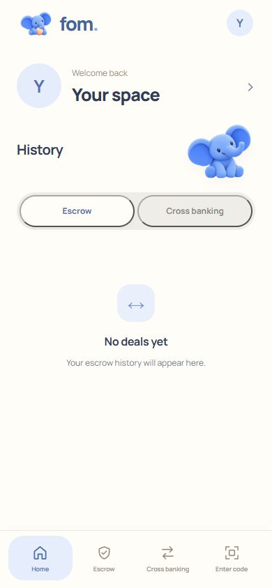
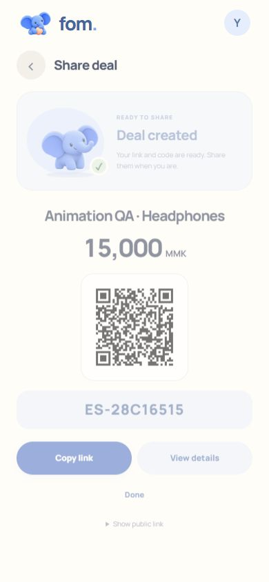
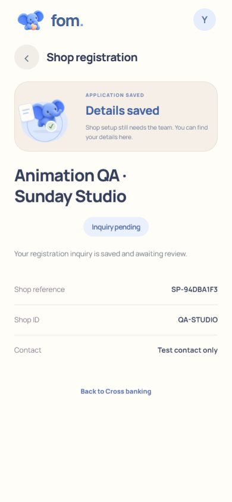

# FOM — Future of Myanmar

Current working local FOM app, refreshed on **23 October 2026**. This snapshot replaces the earlier app files with the current Escrow and Cross banking experience, its motion implementation, validation notes and product-flow screenshots.

## Run the app

Requires Python 3.11 or newer. The local app has no frontend build step or runtime package installation.

```powershell
cd handshake/app
python server.py
```

Open [the customer app](http://127.0.0.1:8800/index.html#home), [the phone preview](http://127.0.0.1:8800/mobile.html), or [the staff workspace](http://localhost:8800/admin.html). On Windows, `handshake/app/Start Handshake.cmd` is also available.

## Current flows

- **Escrow:** create and share a deal → buyer opens the code and chooses a payment method → buyer submits a receipt → seller records the package and its arrival → buyer confirms received and checked → History.
- **Cross banking:** create and share a one-time request → open its code → choose a method and read receiving details → submit the receipt → saved receipt and History.
- **Shop inquiry:** submit shop details → pending review. A saved inquiry does not enable shop payments.
- Reports pause the applicable escrow updates. Existing private browser sessions and the retained legacy staff/provider simulator remain separate from the receipt-only customer flow.

**The current customer MVP records receipts; it does not independently verify payments or move money.** Its receipt acknowledgment explicitly says that payment is not verified. See the revised section of [the application contract](handshake/app/CONTRACT.md).

## Motion

Seven finite milestone treatments cover ten service-specific cases. They start after successful saved actions, keep controls available and preserve static results for reduced motion and keyboard use. The completion reward survives the redirect to History. The original elephant art is retained as a whole image, with separate document, parcel, connection and burst choreography.

The independent first pass reviewed all ten cases through normal, slow and frozen browser playback. Arrival and shop each received exactly one narrow-screen spacing revision. Their final independent check inspected the revised browser screenshots while retaining the unchanged choreography assessment. **All ten meet the requested 7/10 threshold; overall 7.3/10.**

- [Implementation and validation](docs/motion/IMPLEMENTATION.md)
- [Initial critic review](docs/motion/critic-pass1.md)
- [Final critic review](docs/motion/critic-final.md)
- [One-redo record](docs/motion/revision-log.json)
- [Actual browser walkthrough](docs/motion/browser-walkthrough.json)

## Screenshots

The [`screenshots/`](screenshots/README.md) folder contains **115 saved product-flow screenshots**, separated into current screens, milestone captures, motion-review evidence and older app/design snapshots. The [manifest](screenshots/manifest.json) records their source paths and hashes. Competitor screenshots and mascot source artwork are excluded from this product-flow collection.

| Current Home | Deal created | Shop inquiry saved |
|---|---|---|
|  |  |  |

## Validation

```powershell
cd handshake/app
python -m unittest discover -s tests -p "test_*.py" -q
```

All **65 backend tests** passed for this snapshot. Existing customer, payment, two-party escrow and scanner checks passed, along with the new `tests/earned_motion_ui.cjs` lifecycle checks. JavaScript DOM checks require `jsdom`, or `FOM_JSDOM` pointing to an existing installation. Browser verification used isolated synthetic records; it did not modify existing user records.

## Backup boundaries

The full current app source, migrations, bundled assets/licenses, tests and design history are under `handshake/app/`. [SNAPSHOT.json](SNAPSHOT.json) lists the source file hashes. Local databases, uploaded private evidence/account state, environment secrets, logs, process IDs and generated Python caches are excluded from Git. A consistent live-database backup and a bundle of the prior Git history were retained locally before this refresh.

See [the runbook](handshake/app/RUNBOOK.md) for operation and recovery details, and [the product documents](docs/product/) for the retained product/design context.
