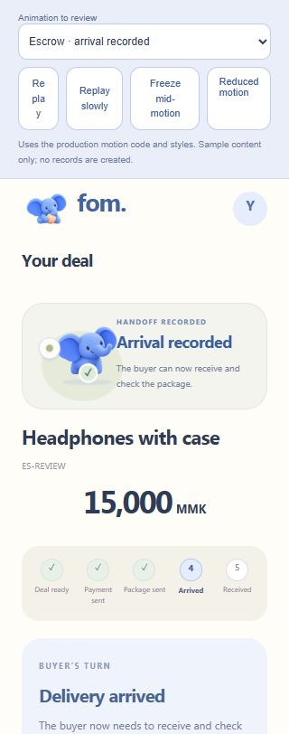
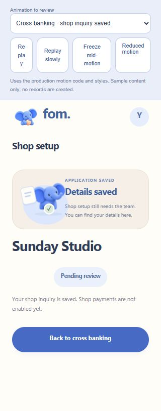

# Independent motion review — pass 1

**Eight accepted; two require one targeted revision. Overall: 7.2/10.** Acceptance threshold: 7/10. Scores are initial ratings; only the two below threshold should receive the user's one permitted revision.

| Case | Score | Decision |
|---|---:|---|
| escrow-create | 7.4/10 | Accepted |
| payment-create | 7.4/10 | Accepted |
| escrow-join | 7.2/10 | Accepted |
| payment-join | 7.0/10 | Accepted |
| escrow-receipt | 7.2/10 | Accepted |
| payment-receipt | 7.2/10 | Accepted |
| escrow-dispatch | 7.3/10 | Accepted |
| escrow-arrived | 6.8/10 | One targeted revision |
| escrow-complete | 7.8/10 | Accepted |
| shop-shop | 6.8/10 | One targeted revision |

## escrow-create — 7.4/10

A paper cue arrives beside the whole-image mascot, then the check and stable sharing card leave the QR and actions as the task focus. Blue/ivory styling fits the app. Familiar rather than distinctive choreography.

## payment-create — 7.4/10

The same ready-to-share grammar appropriately confirms creation of a request. Copy says the link/code are ready and does not claim a transfer. Phone content remains readable.

## escrow-join — 7.2/10

A compact connection cue supports the newly joined deal and the next payment-method step. The card stays out of the controls; KPay could be selected during slow replay. Small prop motion carries more meaning than the mascot bounce.

## payment-join — 7.0/10

Restrained opened-request feedback keeps the method choice visible and states the next action clearly. A success check is a fairly generic treatment for opening a request, but the adjacent copy prevents a payment-success claim.

## escrow-receipt — 7.2/10

The moving paper makes the saved-submission event legible. 'Payment is not verified' stays readable, including at 320px. The shared check/bounce vocabulary is polished enough but adds little distinction from creation.

## payment-receipt — 7.2/10

Submission wording and the explicit unverified-payment message are clear. No blocking overlay or money-movement claim appears. The same paper motion is an economical reuse of the escrow receipt treatment.

## escrow-dispatch — 7.3/10

A package prop and lateral whole-image movement give this state a relevant cue. 'Your photo is saved' accurately describes the recorded evidence; the next arrival action stays separate and usable.

## escrow-arrived — 6.8/10

The quiet greenish arrival treatment appropriately lowers celebration intensity. At 320px, however, the compact mascot's trunk reaches the start of 'Arrival recorded' with essentially no visual breathing room. This persists in the static/reduced treatment.

**Targeted revision:** Reserve visible clearance between the compact illustration and text at 320px: reduce the art or adjust its grid allocation/gap. Keep the restrained arrival choreography and factual copy.

## escrow-complete — 7.8/10

The larger centered stage earns its extra space for the terminal state. The wider halo, small accent burst, check and final rest make a clear peak without covering the History entry. 'Received and checked' describes completion without asserting a money release.

## shop-shop — 6.8/10

The subdued saved-application treatment and pending-review copy correctly avoid shop-activation claims. At 320px the mascot trunk crowds the first letter of 'Details saved'; the small card needs clearer separation even in reduced motion.

**Targeted revision:** Reserve visible clearance between the compact illustration and text at 320px: reduce the art or adjust its grid allocation/gap. Preserve the subdued treatment, Pending review status and payments-not-enabled copy.

## Validation and limits

All ten cases were replayed normally, slowly and frozen mid-motion. All were reviewed at 390px phone width. A 320px check covered representative normal states and every reduced-motion case. The actual Reduced motion link (`?motion=reduce`) retained useful static art and copy; no horizontal document overflow appeared in any of the ten 320px reduced-motion cases.

KPay remained selectable during slow join replay. Scene switching replaced the previous state without a blocking overlay. Real application navigation interruption was not independently repeated; the main agent's real-journey walkthrough remains separate evidence.

This was a frame-based browser review, not a high-frame-rate recording or physical-device performance test. The mascot is a flattened PNG moved as a whole. Repeated check/paper/whole-image staging gives coherence but limits expressiveness, which is why accepted scores remain below 8. No payment, custody, transfer or money-release behavior was independently verified. Receipt and shop copy correctly qualify what was saved.

The OS reduced-motion preference was not toggled independently. CSS animation-name inspection returned no entries even in normal playback, so it was not used as cancellation proof. Reduced-motion judgment rests on visible replay frames. The harness's narrow wrapping review buttons are outside the production UI and were excluded.

## Evidence

